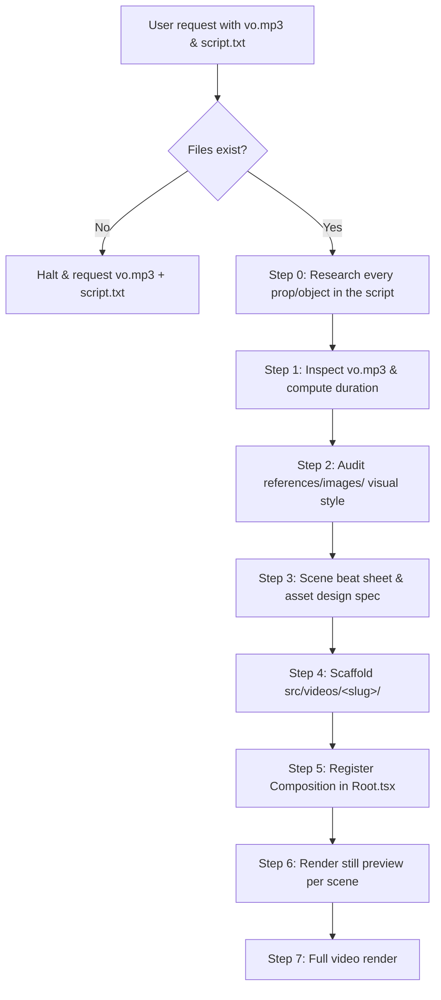

# Remotion Papercraft & 2.5D Stop-Motion Cutout Animation

This skill guides the creation of tactile, physical-looking **Papercraft / Stop-Motion Cutout (2.5D)** short-form videos (9:16 vertical 1080x1920 or 720x1280) inside **Remotion**.

It achieves a high-end stop-motion look (analogous to *South Park*, *Kubo and the Two Strings* paper cutouts, cardboard dioramas, and tabletop pop-up animations) **without Three.js or WebGL**, using pure React, CSS 3D transforms, multi-tiered drop-shadows, paper textures, and stepped frame rates.

---

## 1. Trigger & Prasyarat Wajib (Mandatory Inputs Gate)

Before writing any scene code or setting up compositions, **ALWAYS** enforce this hard gate:

### Mandatory Files Checklist
When a user requests a new video using this skill, they **MUST** provide:
1. `vo.mp3` — Audio voice-over file (the single source of truth for duration, pacing, and cut timing).
2. `script.txt` — Voice-over script with explicit **emotion tags** on every dialogue or scene block.

> [!CAUTION]
> **Hard Stop Rule:** If either `vo.mp3` or `script.txt` is missing from the working directory or designated video folder, **STOP IMMEDIATELY**. Do not guess the timing or script. Prompt the user:
> *"Untuk membuat video papercraft animasi, saya membutuhkan file `vo.mp3` (audio voice-over) dan `script.txt` (naskah dengan tag emosi seperti [excited], [curiously], dll.). Silakan unggah kedua file tersebut terlebih dahulu."*

### Audio Inspection & Timing Extraction
Once `vo.mp3` is provided, calculate the total video frames at **30 fps**:
```bash
# Get duration in seconds
ffprobe -v error -show_entries format=duration -of default=noprint_wrappers=1:nokey=1 vo.mp3
```
Formula:
$$\text{durationInFrames} = \lceil \text{durationInSeconds} \times 30 \rceil$$

### Script Format with Emotion Tags
`script.txt` must follow this structure:
```text
[excited]
Adik-adik! Pernah nggak kalian melihat pesawat terbang tinggi di langit?

[curiously]
Tapi... bagaimana ya benda sebesar itu bisa terbang padahal beratnya ribuan kilogram?

[thoughtful]
Ternyata rahasianya ada pada bentuk sayapnya yang unik!

[shocked]
Tanpa bentuk sayap ini, pesawat akan langsung jatuh berdebam ke tanah!

[triumphant]
Dengan gaya angkat udara, pesawat pun bisa melayang bebas seperti burung kertas!
```

---

## 2. Autonomous Visual Reference Analysis (`references/images/`)

The workspace contains a `references/images/` folder holding visual reference files with **arbitrary filenames** (e.g., `image_001.jpg`, `shot4.png`, `assetA.jpeg`, `reference-style.webp`).

When starting a project or generating visuals:
1. **List all files** in `references/images/` (`ls references/images/`).
2. **Inspect sample frames** using read tools or visual inspection commands.
3. **Perform a 5-Point Style Audit** and synthesize the findings into the project's visual theme:
   - **Tabletop / Paper Base:** Is it kraft cardboard, recycled textured paper, parchment, blueprint, or a topographical map?
   - **Color Palette:** Extract dominant hex codes (Background base, Primary cutout tint, Secondary accents, Contrast lines).
   - **Cutout Border Style:** Are cutouts bordered with a crisp white die-cut cardstock edge (`border: 3px solid #fff`), a raw rough-cut dark edge, or unbordered folded paper?
   - **Lighting & Shadows:** 
     - Light source direction (standard: top-left ~315° / -45°).
     - Shadow tone (warm translucent umber `rgba(45, 30, 20, 0.35)` vs neutral charcoal `rgba(0, 0, 0, 0.4)`).
     - Layer elevation separation (Z0 surface, Z1 flat underlay, Z2 elevated prop, Z3 floating/popping actor).
   - **Perspective & Framing:** Top-down flat-lay (overhead desk), 2.5D diorama tilt (`perspective(1200px) rotateX(15deg)`), or pop-up book fold.

---

## 3. Monorepo Multi-Composition Architecture

This codebase is a **Single Monorepo** capable of hosting multiple distinct video shorts without reinstalling or re-scaffolding Remotion.

### Directory Structure
```text
project-root/
├── package.json
├── remotion.config.ts
├── tsconfig.json
├── references/                    # Reference guides & visual study
│   ├── emotion-spring-matrix.md   # Spring dynamics & shadow math
│   └── images/                    # Visual reference frames (arbitrary image names)
│       ├── image_001.jpg
│       ├── image_002.jpg
│       └── ...
├── public/
│   ├── textures/
│   │   ├── kraft-paper.jpg        # Shared paper & fiber grain
│   │   └── craft-rough.png
│   └── sfx/                       # Shared stop-motion paper sound effects
│       ├── paper-slide.mp3
│       ├── paper-pop.mp3
│       └── paper-thud.mp3
├── src/
│   ├── index.ts                   # Remotion entry point
│   ├── Root.tsx                   # Central composition registry (multi-video)
│   ├── shared/                    # Reusable Papercraft Design System
│   │   ├── components/
│   │   │   ├── PaperCutout.tsx    # 2.5D cutout container with dynamic drop-shadow
│   │   │   ├── PopUpPaper.tsx     # 3D folding paper flap/pop-up hinge
│   │   │   ├── PaperTextPill.tsx  # Stop-motion text badge/caption
│   │   │   └── PaperTabletop.tsx  # Textured desk background with lighting gradient
│   │   ├── hooks/
│   │   │   └── useStopMotion.ts   # Stepped frames + useSettleWiggle (bounded settle wobble, then frozen)
│   │   └── styles/
│   │       └── paperTheme.ts
│   └── videos/                    # Individual video projects
│       ├── pesawat-terbang/       # Video 1
│       │   ├── vo.mp3             # Voiceover audio
│       │   ├── script.txt         # Emotion-tagged script
│       │   ├── story.ts           # Timings, beat breakdown & asset mapping
│       │   ├── PesawatShort.tsx   # Main composition component
│       │   ├── scenes/
│       │   │   ├── Scene1Intro.tsx
│       │   │   ├── Scene2WingLift.tsx
│       │   │   └── Scene3Outro.tsx
│       │   └── assets/            # Video-specific cutouts/SVGs
│       └── uang-pajak/            # Video 2
│           ├── vo.mp3
│           ├── script.txt
│           ├── story.ts
│           └── UangPajakShort.tsx
```

### Composition Registration in `src/Root.tsx`
Never recreate projects. Simply create a new directory in `src/videos/<slug>/` and register it in `src/Root.tsx`:

```tsx
// src/Root.tsx
import React from "react";
import { Composition } from "remotion";
import { PesawatShort, PESAWAT_TOTAL_FRAMES } from "./videos/pesawat-terbang/PesawatShort";
import { UangPajakShort, UANG_PAJAK_TOTAL_FRAMES } from "./videos/uang-pajak/UangPajakShort";

export const RemotionRoot: React.FC = () => {
  return (
    <>
      <Composition
        id="PesawatTerbang"
        component={PesawatShort}
        durationInFrames={PESAWAT_TOTAL_FRAMES}
        fps={30}
        width={1080}
        height={1920}
      />
      <Composition
        id="UangPajak"
        component={UangPajakShort}
        durationInFrames={UANG_PAJAK_TOTAL_FRAMES}
        fps={30}
        width={1080}
        height={1920}
      />
    </>
  );
};
```

---

## 4. Emotion-to-Physics Dynamics Engine

Papercraft animation gains its life and humor from how elements pop, wobble, land, and hesitate. Always read the emotion tag from `script.txt` for each scene beat and configure the physics accordingly:

| Emotion Tag | Remotion Spring Config | Motion Behavior & Visual Cues |
| :--- | :--- | :--- |
| `[excited]` / `[gembira]` | `{ damping: 10, stiffness: 220, mass: 0.6 }` | **Bouncy Pop-in:** Element shoots up with overshoot (scale 0 $\to$ 1.15 $\to$ 1.0), playful rotation wobble ($\pm 4^\circ$), quick paper rustle SFX. |
| `[curiously]` / `[penasaran]` | `{ damping: 16, stiffness: 110, mass: 0.9 }` | **Hesitant Float:** Moderate speed, element tilts slowly to the side ($6^\circ$ to $10^\circ$), subtle hover lift (Z-axis rises by 25px, shadow softens). |
| `[shocked]` / `[kaget]` | `{ damping: 7, stiffness: 320, mass: 0.4 }` | **Violent Snap:** Instant jump up 40px, wide shadow expansion, screen micro-shake (camera kick), fast vibration. |
| `[thoughtful]` / `[serius]` | `{ damping: 20, stiffness: 140, mass: 1.1 }` | **Deliberate Placement:** Smooth, zero or minimal overshoot. Element lands with a firm thud (`scale: 1.05 -> 1.0`), solid dense contact shadow. |
| `[sad]` / `[down]` | `{ damping: 24, stiffness: 60, mass: 1.4 }` | **Slow Droop:** Overdamped, sluggish descent. Element slowly tilts downward ($-8^\circ$), sliding slightly down on the Y-axis. |
| `[triumphant]` / `[bangga]` | `{ damping: 12, stiffness: 180, mass: 0.7 }` | **Ascent & Fanfare:** Sweeping entrance from bottom-center, scales up proudly, accompanied by bursting paper sunray cutouts. |
| `[whisper]` / `[rahasia]` | `{ damping: 18, stiffness: 130, mass: 0.8 }` | **Creeping Slide:** Element sneaks in horizontally from behind another cutout layer with low elevation shadow. |

### Remotion Implementation Example:
```tsx
import { spring, useCurrentFrame, useVideoConfig } from "remotion";

export const getEmotionSpring = (
  frame: number, 
  fps: number, 
  emotion: string, 
  delay: number = 0
) => {
  const configs: Record<string, { damping: number; stiffness: number; mass: number }> = {
    excited: { damping: 10, stiffness: 220, mass: 0.6 },
    curiously: { damping: 16, stiffness: 110, mass: 0.9 },
    shocked: { damping: 7, stiffness: 320, mass: 0.4 },
    thoughtful: { damping: 20, stiffness: 140, mass: 1.1 },
    sad: { damping: 24, stiffness: 60, mass: 1.4 },
    triumphant: { damping: 12, stiffness: 180, mass: 0.7 },
  };

  const config = configs[emotion] || configs.thoughtful;

  return spring({
    frame: frame - delay,
    fps,
    config,
  });
};
```

---

## 5. Pure 2.5D Papercraft Technical Stack (No WebGL)

### 1. Stop-Motion Stepped Frame Hook (`useStopMotionFrame`)
In real stop-motion, animations run at **10, 12, or 15 fps**, not continuous 60 fps. This quantizer gives authentic stop-motion cadence. **Stepped frames are for stepped POSITIONS only** (slide waypoints, slide-in offsets) — never feed them into `spring()`, which needs the raw continuous frame to resolve its own smooth curve (see §5.6).

```tsx
// src/shared/hooks/useStopMotion.ts
import { useCurrentFrame } from "remotion";

export const useStopMotionFrame = (step: number = 2): number => {
  const frame = useCurrentFrame();
  // step = 2 converts 30 fps to 15 fps; step = 3 converts to 10 fps
  return Math.floor(frame / step) * step;
};

/**
 * useSettleWiggle — the ONLY idle-motion hook.
 * There is no free-running wiggle hook — do not create one.
 * Plays a decaying wobble inside [startFrame, startFrame + durationFrames],
 * then returns exactly { rotate: 0, deltaX: 0, deltaY: 0 } — frozen.
 */
export const useSettleWiggle = (
  rawFrame: number,
  opts: { startFrame: number; durationFrames?: number; intensity?: number } = { startFrame: 0 }
): { rotate: number; deltaX: number; deltaY: number } => {
  const { startFrame, durationFrames = 16, intensity = 0.5 } = opts;
  const t = (rawFrame - startFrame) / durationFrames;
  if (t < 0 || t > 1) return { rotate: 0, deltaX: 0, deltaY: 0 };
  const decay = (1 - t) * (1 - t);
  return {
    rotate: Math.sin(t * Math.PI * 3) * 1.2 * intensity * decay,
    deltaX: Math.cos(t * Math.PI * 2) * 2 * intensity * decay,
    deltaY: Math.sin(t * Math.PI * 2) * 2 * intensity * decay,
  };
};
```

### 2. Multi-Tier Dynamic Drop Shadows
In papercraft, depth is conveyed through shadows. As an element lifts off the desk, its shadow shifts further down-right, blurs, and becomes more transparent:

```tsx
// src/shared/components/PaperCutout.tsx
import React from "react";
import { interpolate } from "remotion";

interface PaperCutoutProps {
  children: React.ReactNode;
  elevation?: number; // 0 (flat on table) to 4 (high in air)
  liftProgress?: number; // 0 (resting) to 1 (lifted)
  whiteBorder?: boolean;
  className?: string;
  style?: React.CSSProperties;
}

export const PaperCutout: React.FC<PaperCutoutProps> = ({
  children,
  elevation = 1,
  liftProgress = 0,
  whiteBorder = true,
  className = "",
  style = {},
}) => {
  const currentElevation = elevation + liftProgress * 2;

  // Dynamic shadow calculation based on elevation
  const shadowX = interpolate(currentElevation, [0, 1, 2, 3, 4], [1, 3, 6, 12, 20]);
  const shadowY = interpolate(currentElevation, [0, 1, 2, 3, 4], [2, 6, 14, 26, 40]);
  const shadowBlur = interpolate(currentElevation, [0, 1, 2, 3, 4], [2, 6, 12, 22, 35]);
  const shadowAlpha = interpolate(currentElevation, [0, 1, 2, 3, 4], [0.4, 0.35, 0.28, 0.2, 0.15]);

  return (
    <div
      className={className}
      style={{
        display: "inline-block",
        position: "relative",
        filter: `drop-shadow(${shadowX}px ${shadowY}px ${shadowBlur}px rgba(35, 25, 20, ${shadowAlpha}))`,
        ...style,
      }}
    >
      <div
        style={{
          border: whiteBorder ? "3px solid #FAF8F5" : "none",
          borderRadius: "8px",
          overflow: "hidden",
          backgroundColor: "#FAF8F5",
        }}
      >
        {children}
      </div>
    </div>
  );
};
```

### 3. 3D Pop-Up Book Fold Hinge (`PopUpPaper`)
Simulates a cutout folding up from a flat page around its bottom edge using CSS 3D:

```tsx
// src/shared/components/PopUpPaper.tsx
import React from "react";
import { interpolate } from "remotion";

interface PopUpPaperProps {
  children: React.ReactNode;
  progress: number; // 0 (flat on desk) to 1 (standing 90 deg up)
  perspective?: number;
}

export const PopUpPaper: React.FC<PopUpPaperProps> = ({
  children,
  progress,
  perspective = 1000,
}) => {
  // -90deg is flat down facing forward, 0deg is standing perpendicular to the viewer
  const rotateX = interpolate(progress, [0, 1], [-85, 0]);
  const opacity = interpolate(progress, [0, 0.2, 1], [0, 0.8, 1]);

  return (
    <div
      style={{
        perspective: `${perspective}px`,
        transformStyle: "preserve-3d",
        display: "inline-block",
      }}
    >
      <div
        style={{
          transformOrigin: "bottom center",
          transform: `rotateX(${rotateX}deg)`,
          opacity,
          backfaceVisibility: "hidden",
        }}
      >
        {children}
      </div>
    </div>
  );
};
```

### 4. Stop-Motion Subtitle Pill (`PaperTextPill`)
Tactile speech card. **Captions must be rock-solid — NO jitter, NO rotation, NO wiggle.** Readability beats texture.

```tsx
// src/shared/components/PaperTextPill.tsx
import React from "react";

interface PaperTextPillProps {
  text: string;
  subtext?: string;
  highlightWords?: string[];
}

export const PaperTextPill: React.FC<PaperTextPillProps> = ({ text }) => {
  // NOTE: no useCurrentFrame, no steppedFrame, no sin/cos jitter here.
  // Caption stays pixel-frozen so viewers can read it.
  return (
    <div
      style={{
        position: "absolute",
        bottom: 120,
        left: 0,
        right: 0,
        display: "flex",
        justifyContent: "center",
        zIndex: 100,
      }}
    >
      <div
        style={{
          backgroundColor: "#FFFFFF",
          padding: "16px 36px",
          borderRadius: "28px",
          maxWidth: "85%",
          textAlign: "center",
          boxShadow: "0 10px 24px rgba(30, 20, 15, 0.22), 0 2px 6px rgba(0, 0, 0, 0.08)",
          border: "2px solid #F0EEE9",
        }}
      >
        <span
          style={{
            fontFamily: "Inter, system-ui, sans-serif",
            fontSize: "34px",
            fontWeight: 800,
            color: "#1E1E1E",
            letterSpacing: "-0.5px",
            lineHeight: 1.3,
          }}
        >
          {text}
        </span>
      </div>
    </div>
  );
};
```

---

## 5.5 Papercraft Material Rules (Strict — Do Not Deviate)

A `PaperCutout` wrapper alone does NOT make papercraft. Flat digital UI inside a drop-shadow still looks digital. Every cutout must pass these material rules, or the still-preview gate (Step 6) FAILS.

### Banned (instant papercraft fail)
- **Emoji as characters/props** (😊 ❄️ 💨 🛏️ ⛄). Emoji are glossy digital glyphs — they kill the paper illusion on sight. Build faces, weather, and objects from paper SVG/CSS shapes (circle head + paper-dot eyes + cut smile strip).
- **Inset shadows / glassmorphism / clean CSS gradients** as surfaces (`box-shadow: inset ...`, `repeating-linear-gradient` wallpaper, glossy temp displays). Real paper has no inner glow. All surfaces = flat matte color + grain overlay.
- **Thin 2–5px clean borders** passed off as "die-cut". On a 1080×1920 canvas a real cardstock edge reads at **8–12px**, off-white `#FFFDF8`, with a slightly irregular radius (e.g. `18px 22px 20px 24px` — never four identical corners).
- **Text-label boxes as props** (a rounded rectangle that just says "SELIMUT TEBAL 🛏️" is a caption, not a blanket). Every prop needs a recognizable **silhouette first**, text second.

### Mandatory layer stack (every cutout)
1. **Base silhouette** — the shape that reads at a glance (AC body, blanket-covered sleeper, droplet).
2. **1–2 detail layers** — vent slats, LED strip, quilt stitch lines, droplet shine — as separate stacked paper strips, NOT painted-on gradients.
3. **Grain overlay** — SVG `feTurbulence` fiber or `staticFile("textures/kraft-paper.jpg")` at **opacity ≥ 0.25** on the cutout itself, not only on the tabletop. Tabletop-only grain is invisible after video compression.
4. **Warm cast shadow** — `rgba(35, 25, 20, α)` via `PaperCutout` elevation. No neutral-gray or black-only shadows.

### Static earth rule
Walls, room panels, tabletops, and background decor are the **table — tables don't shake**. They get **zero transform, zero wiggle, zero spring**. Any `rotate`/`translate` on a background element is a fail.

---

## 5.6 Wiggle Discipline & Motion Ownership (Strict)

Uncontrolled wiggle is why "semua part goyang-goyang". Follow this exactly:

### One motion owner per element per beat
NEVER stack `spring scale` + `wiggle rotate` + `sin pulse translateY` on the same `<div>`. Pick ONE per beat:
- entrance → emotion spring, **then freeze**, or
- settle → `useSettleWiggle` for 12–20 frames after landing, **then freeze**, or
- ambient float → ONLY for airborne things (clouds, breeze strips, birds), amplitude ≤ 4px, period ≥ 60 frames.

Grounded props (AC unit on wall, sleeper on bed, badges, titles) NEVER float. If it rests on something, it is frozen after landing.

### spring() takes RAW frame, never stepped frame
```tsx
// CORRECT
const rawFrame = useCurrentFrame();
const pop = getEmotionSpring(rawFrame, 30, "excited", 5); // smooth spring curve
const sFrame = useStopMotionFrame(2);                      // stepped, for stepped positions only
const settle = useSettleWiggle(rawFrame, { startFrame: 5, durationFrames: 16, intensity: 0.5 });

// WRONG — stepping the spring input creates stutter-overshoot that never settles
const frame = useStopMotionFrame(2);
const pop = getEmotionSpring(frame, 30, "excited", 5); // ❌ do not do this
```

### Where wiggle is allowed
- **Allowed:** ONE hero character/prop per scene, settle window only (12–20 frames post-entrance) or low idle (`intensity ≤ 0.5`, rotate ≤ 0.6°).
- **Forbidden:** walls, room panels, tabletops, title badges, question badges, captions, subtitles, `PaperTextPill`. If everything moves, nothing feels like stop-motion. **Default state = FROZEN.** Motion must earn its place in the beat sheet (Step 3) with a concrete verb — "settles 0.5° over 14 frames", not "wiggles".

---

## 6. End-to-End Execution Workflow

Follow these steps sequentially every time a video is requested:



---

### Step 0: Mandatory Topic & Prop Research ⚠️ NEVER SKIP

> [!CAUTION]
> **This step is NOT optional.** Do NOT start writing any scene or component code until this research is complete and written down. Skipping this step produces generic, inaccurate, or placeholder visuals.

For every **distinct real-world object or location** mentioned in `script.txt`, conduct visual research and answer these questions before designing any SVG/CSS asset:

#### 0a. Object Identification
Extract every tangible prop and scene element from the script. Example for a script about AC/air conditioner:
- Indoor unit (AC split wall-mounted): What shape exactly? Where is the air vent? Where is the display panel? What is the aspect ratio of the body?
- Outdoor unit (compressor): What does the grille look like? How big is it relative to the indoor unit? Where are the pipes?
- Refrigerant pipes: How many? What diameter? What color?
- Room interior: What type of wall, ceiling height, window placement?

#### 0b. Research Protocol
For each identified prop:
1. Describe the **real-world appearance** in detail (shape, proportions, color, texture, distinguishing features).
2. Decide how it is **simplified into a papercraft cutout** — what silhouette captures it at a glance? What must be preserved to be recognizable?
3. Plan the **layer stack**: background layer → structural body → details overlay → highlight/shine.
4. Write a **1-paragraph prop description** before creating any code for it.

#### 0c. Research Output (write before coding)
Before the first `src/` file, write a `RESEARCH.md` or inline comment block titled `// PROP RESEARCH` in `story.ts` documenting:
```
PROP: [Name]
Real shape: [description]
Papercraft simplification: [how it becomes a cutout]
Dominant colors: [hex list]
Key details to preserve: [e.g., horizontal louver vent, LED indicator strip]
Layer order: [background → body → ...  → foreground]
```

---

### Step 1: Pre-flight Verification
1. Check `vo.mp3` existence and run:
   ```bash
   ffprobe -v error -show_entries format=duration -of default=noprint_wrappers=1:nokey=1 vo.mp3
   ```
2. Read `script.txt`. Extract each line's emotion tag: `[excited]`, `[curiously]`, etc.

### Step 2: Visual Reference Audit
1. Run `ls references/images/`.
2. Inspect at least 5 spread frames across the image list.
3. Identify and document:
   - Desk/table texture color and grain.
   - Cutout border style (white die-cut vs raw edge vs embossed).
   - Shadow warmth and angle.
   - Any motion pattern (slide in, pop up, fold, zoom).

### Step 3: Scene Beat Sheet & Asset Design Spec
For each emotion-tagged section of `script.txt`:
- Assign a frame range `[startFrame, endFrame]`.
- List which props are visible and at which Z-elevation.
- Describe the **specific animation action** for that beat (do not use vague descriptions like "it moves" — be concrete: "AC indoor unit slides in from right at elevation Z2, overshoots 8px, settles").

### Step 4: Video Scaffolding
Create `src/videos/<slug>/` containing:
- `story.ts` (frame markers, emotion tags, prop research notes).
- Main video component (e.g., `AcShort.tsx`).
- `scenes/` (individual animated scenes, one file per beat or scene group).
- `assets/` (SVG/CSS definitions for props).

### Step 5: Register Composition
Update `src/Root.tsx` by importing the new component and appending a `<Composition />` entry with exact `durationInFrames`, `fps={30}`, `width={1080}`, `height={1920}`.

### Step 6: Per-Scene Still Preview
Render one still per major scene before assembling the final render:
```bash
npx remotion still <CompositionId> out/still_scene1.png --frame=30
npx remotion still <CompositionId> out/still_scene2.png --frame=90
```
Review each still for: papercraft texture present? shadow correct? prop recognizable?

### Step 7: Full Video Render
```bash
npx remotion render <CompositionId> out/<slug>.mp4
```

---

## 7. Caption Rules (Strict — Do Not Deviate)

Captions are the **single most visible** element. Bad captions kill the vibe. Follow these rules absolutely:

### 7a. Length Rule
- **Maximum 4–5 words per caption card.**
- If a script line is long (e.g., "AC bekerja dengan cara memindahkan panas dari dalam ruangan ke luar ruangan"), **split it into multiple sequential caption cards**, each showing 4–5 words timed to the voice-over.
- Never display a full sentence at once.

### 7b. Word-by-Word Highlight Animation
Every caption must implement **active word highlight** — the word currently being spoken is highlighted differently from inactive words:

```tsx
// Active word highlight caption implementation
interface CaptionProps {
  words: string[];         // e.g. ["AC", "bekerja", "dengan"]
  activeWordIndex: number; // which word is currently spoken (driven by frame timing)
}

export const PaperCaption: React.FC<CaptionProps> = ({ words, activeWordIndex }) => {
  return (
    <div style={{ display: "flex", gap: "8px", flexWrap: "wrap", justifyContent: "center" }}>
      {words.map((word, i) => (
        <span
          key={i}
          style={{
            fontSize: "40px",
            fontWeight: 900,
            color: i === activeWordIndex ? "#FF4B2B" : "#1C1917",         // active = accent color
            textShadow: i === activeWordIndex ? "0 2px 12px rgba(255,75,43,0.4)" : "none",
            transform: i === activeWordIndex ? "scale(1.08)" : "scale(1)",
            transition: "none", // no CSS transition — step-change per stop-motion frame
            display: "inline-block",
          }}
        >
          {word}
        </span>
      ))}
    </div>
  );
};
```

### 7c. Caption Timing
Drive `activeWordIndex` from the frame, using the word's approximate duration from the script pacing:
```tsx
// Approximate: evenly distribute words across the beat's frame range
const wordsPerBeat = words.length;
const framesPerWord = Math.floor((beatEndFrame - beatStartFrame) / wordsPerBeat);
const activeWordIndex = Math.min(
  Math.floor((frame - beatStartFrame) / framesPerWord),
  wordsPerBeat - 1
);
```

---

## 8. Golden Rules of 2.5D Papercraft

1. **Always research every real-world prop before drawing it.** An unresearched prop looks like a placeholder rectangle. Write the prop description first, code second.
2. **Never use Three.js / WebGL.** All depth = CSS 3D transforms + stacked layers + drop-shadows.
3. **Stepped frames for positions, raw frames for springs.** `useStopMotionFrame()` drives stepped positions; `spring()` and `getEmotionSpring()` ALWAYS take the raw `useCurrentFrame()`. Stepping a spring input creates stutter-overshoot. See §5.6.
4. **Default state = FROZEN.** Backgrounds, walls, badges, and captions get zero transform. Only one hero element per scene may settle-wiggle (12–20 frames post-entrance) or ambient-float (airborne only, ≤ 4px). See §5.6.
4. **Always cast grounded shadows.** Every elevated cutout must have a shadow that shifts, blurs, and fades as elevation increases.
5. **Never create a new Remotion project from scratch.** Always add to `src/videos/<slug>/` and register in `src/Root.tsx`.
6. **Always sync spring dynamics to emotion tags.** The motion physics is the acting — treat it seriously.
7. **Captions: 4–5 words max, with word-highlight active animation.** Never dump a full sentence.
8. **Render per-scene stills before full render.** Catch papercraft style failures early, not at the end.
