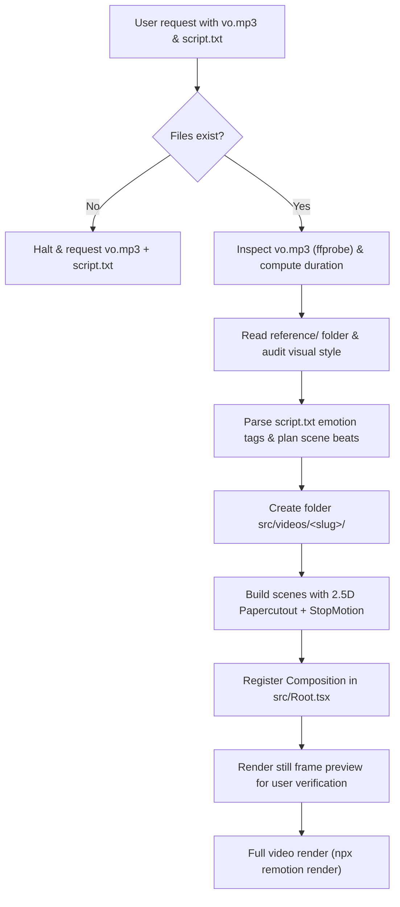

# Remotion Papercraft & 2.5D Stop-Motion Cutout Animation

This skill guides the creation of tactile, physical-looking **Papercraft / Stop-Motion Cutout (2.5D)** short-form videos (9:16 vertical 1080x1920 or 720x1280) inside **Remotion**.

It achieves a high-end stop-motion look (analogous to *South Park*, *Kubo and the Two Strings* paper cutouts, cardboard dioramas, and tabletop pop-up animations) **without Three.js or WebGL**, using pure React, CSS 3D transforms, multi-tiered drop-shadows, paper textures, and stepped frame rates.

---

## 1. Trigger & Prasyarat Wajib (Mandatory Inputs Gate)

Before writing any scene code or setting up compositions, **ALWAYS** enforce this hard gate:

### Mandatory Files Checklist
When a user requests a new video using this skill, they **MUST** provide:
1. `vo.mp3` — Audio voice-over file (the single source of truth for duration, pacing, and cut timing).
2. `script.txt` — Voice-over script with explicit **emotion tags** on every dialogue or scene block.

> [!CAUTION]
> **Hard Stop Rule:** If either `vo.mp3` or `script.txt` is missing from the working directory or designated video folder, **STOP IMMEDIATELY**. Do not guess the timing or script. Prompt the user:
> *"Untuk membuat video papercraft animasi, saya membutuhkan file `vo.mp3` (audio voice-over) dan `script.txt` (naskah dengan tag emosi seperti [excited], [curiously], dll.). Silakan unggah kedua file tersebut terlebih dahulu."*

### Audio Inspection & Timing Extraction
Once `vo.mp3` is provided, calculate the total video frames at **30 fps**:
```bash
# Get duration in seconds
ffprobe -v error -show_entries format=duration -of default=noprint_wrappers=1:nokey=1 vo.mp3
```
Formula:
$$\text{durationInFrames} = \lceil \text{durationInSeconds} \times 30 \rceil$$

### Script Format with Emotion Tags
`script.txt` must follow this structure:
```text
[excited]
Adik-adik! Pernah nggak kalian melihat pesawat terbang tinggi di langit?

[curiously]
Tapi... bagaimana ya benda sebesar itu bisa terbang padahal beratnya ribuan kilogram?

[thoughtful]
Ternyata rahasianya ada pada bentuk sayapnya yang unik!

[shocked]
Tanpa bentuk sayap ini, pesawat akan langsung jatuh berdebam ke tanah!

[triumphant]
Dengan gaya angkat udara, pesawat pun bisa melayang bebas seperti burung kertas!
```

---

## 2. Autonomous Visual Reference Analysis (`reference/`)

The workspace contains a `reference/` folder holding image files with **arbitrary filenames** (e.g., `image_001.jpg`, `shot4.png`, `assetA.jpeg`, `reference-style.webp`).

When starting a project or generating visuals:
1. **List all files** in `reference/` (`ls reference/`).
2. **Inspect sample frames** using read tools or visual inspection commands.
3. **Perform a 5-Point Style Audit** and synthesize the findings into the project's visual theme:
   - **Tabletop / Paper Base:** Is it kraft cardboard, recycled textured paper, parchment, blueprint, or a topographical map?
   - **Color Palette:** Extract dominant hex codes (Background base, Primary cutout tint, Secondary accents, Contrast lines).
   - **Cutout Border Style:** Are cutouts bordered with a crisp white die-cut cardstock edge (`border: 3px solid #fff`), a raw rough-cut dark edge, or unbordered folded paper?
   - **Lighting & Shadows:** 
     - Light source direction (standard: top-left ~315° / -45°).
     - Shadow tone (warm translucent umber `rgba(45, 30, 20, 0.35)` vs neutral charcoal `rgba(0, 0, 0, 0.4)`).
     - Layer elevation separation (Z0 surface, Z1 flat underlay, Z2 elevated prop, Z3 floating/popping actor).
   - **Perspective & Framing:** Top-down flat-lay (overhead desk), 2.5D diorama tilt (`perspective(1200px) rotateX(15deg)`), or pop-up book fold.

---

## 3. Monorepo Multi-Composition Architecture

This codebase is a **Single Monorepo** capable of hosting multiple distinct video shorts without reinstalling or re-scaffolding Remotion.

### Directory Structure
```text
project-root/
├── package.json
├── remotion.config.ts
├── tsconfig.json
├── reference/                     # User visual references (arbitrary image names)
│   ├── image_001.jpg
│   ├── image_002.jpg
│   └── ...
├── public/
│   ├── textures/
│   │   ├── kraft-paper.jpg        # Shared paper & fiber grain
│   │   └── craft-rough.png
│   └── sfx/                       # Shared stop-motion paper sound effects
│       ├── paper-slide.mp3
│       ├── paper-pop.mp3
│       └── paper-thud.mp3
├── src/
│   ├── index.ts                   # Remotion entry point
│   ├── Root.tsx                   # Central composition registry (multi-video)
│   ├── shared/                    # Reusable Papercraft Design System
│   │   ├── components/
│   │   │   ├── PaperCutout.tsx    # 2.5D cutout container with dynamic drop-shadow
│   │   │   ├── PopUpPaper.tsx     # 3D folding paper flap/pop-up hinge
│   │   │   ├── PaperTextPill.tsx  # Stop-motion text badge/caption
│   │   │   └── PaperTabletop.tsx  # Textured desk background with lighting gradient
│   │   ├── hooks/
│   │   │   ├── useStopMotion.ts   # Stepped frame rate quantizer (12-15 fps)
│   │   │   └── usePaperWiggle.ts  # Subtle micro-jitter/wobble for tactile realism
│   │   └── styles/
│   │       └── paperTheme.ts
│   └── videos/                    # Individual video projects
│       ├── pesawat-terbang/       # Video 1
│       │   ├── vo.mp3             # Voiceover audio
│       │   ├── script.txt         # Emotion-tagged script
│       │   ├── story.ts           # Timings, beat breakdown & asset mapping
│       │   ├── PesawatShort.tsx   # Main composition component
│       │   ├── scenes/
│       │   │   ├── Scene1Intro.tsx
│       │   │   ├── Scene2WingLift.tsx
│       │   │   └── Scene3Outro.tsx
│       │   └── assets/            # Video-specific cutouts/SVGs
│       └── uang-pajak/            # Video 2
│           ├── vo.mp3
│           ├── script.txt
│           ├── story.ts
│           └── UangPajakShort.tsx
```

### Composition Registration in `src/Root.tsx`
Never recreate projects. Simply create a new directory in `src/videos/<slug>/` and register it in `src/Root.tsx`:

```tsx
// src/Root.tsx
import React from "react";
import { Composition } from "remotion";
import { PesawatShort, PESAWAT_TOTAL_FRAMES } from "./videos/pesawat-terbang/PesawatShort";
import { UangPajakShort, UANG_PAJAK_TOTAL_FRAMES } from "./videos/uang-pajak/UangPajakShort";

export const RemotionRoot: React.FC = () => {
  return (
    <>
      <Composition
        id="PesawatTerbang"
        component={PesawatShort}
        durationInFrames={PESAWAT_TOTAL_FRAMES}
        fps={30}
        width={1080}
        height={1920}
      />
      <Composition
        id="UangPajak"
        component={UangPajakShort}
        durationInFrames={UANG_PAJAK_TOTAL_FRAMES}
        fps={30}
        width={1080}
        height={1920}
      />
    </>
  );
};
```

---

## 4. Emotion-to-Physics Dynamics Engine

Papercraft animation gains its life and humor from how elements pop, wobble, land, and hesitate. Always read the emotion tag from `script.txt` for each scene beat and configure the physics accordingly:

| Emotion Tag | Remotion Spring Config | Motion Behavior & Visual Cues |
| :--- | :--- | :--- |
| `[excited]` / `[gembira]` | `{ damping: 10, stiffness: 220, mass: 0.6 }` | **Bouncy Pop-in:** Element shoots up with overshoot (scale 0 $\to$ 1.15 $\to$ 1.0), playful rotation wobble ($\pm 4^\circ$), quick paper rustle SFX. |
| `[curiously]` / `[penasaran]` | `{ damping: 16, stiffness: 110, mass: 0.9 }` | **Hesitant Float:** Moderate speed, element tilts slowly to the side ($6^\circ$ to $10^\circ$), subtle hover lift (Z-axis rises by 25px, shadow softens). |
| `[shocked]` / `[kaget]` | `{ damping: 7, stiffness: 320, mass: 0.4 }` | **Violent Snap:** Instant jump up 40px, wide shadow expansion, screen micro-shake (camera kick), fast vibration. |
| `[thoughtful]` / `[serius]` | `{ damping: 20, stiffness: 140, mass: 1.1 }` | **Deliberate Placement:** Smooth, zero or minimal overshoot. Element lands with a firm thud (`scale: 1.05 -> 1.0`), solid dense contact shadow. |
| `[sad]` / `[down]` | `{ damping: 24, stiffness: 60, mass: 1.4 }` | **Slow Droop:** Overdamped, sluggish descent. Element slowly tilts downward ($-8^\circ$), sliding slightly down on the Y-axis. |
| `[triumphant]` / `[bangga]` | `{ damping: 12, stiffness: 180, mass: 0.7 }` | **Ascent & Fanfare:** Sweeping entrance from bottom-center, scales up proudly, accompanied by bursting paper sunray cutouts. |
| `[whisper]` / `[rahasia]` | `{ damping: 18, stiffness: 130, mass: 0.8 }` | **Creeping Slide:** Element sneaks in horizontally from behind another cutout layer with low elevation shadow. |

### Remotion Implementation Example:
```tsx
import { spring, useCurrentFrame, useVideoConfig } from "remotion";

export const getEmotionSpring = (
  frame: number, 
  fps: number, 
  emotion: string, 
  delay: number = 0
) => {
  const configs: Record<string, { damping: number; stiffness: number; mass: number }> = {
    excited: { damping: 10, stiffness: 220, mass: 0.6 },
    curiously: { damping: 16, stiffness: 110, mass: 0.9 },
    shocked: { damping: 7, stiffness: 320, mass: 0.4 },
    thoughtful: { damping: 20, stiffness: 140, mass: 1.1 },
    sad: { damping: 24, stiffness: 60, mass: 1.4 },
    triumphant: { damping: 12, stiffness: 180, mass: 0.7 },
  };

  const config = configs[emotion] || configs.thoughtful;

  return spring({
    frame: frame - delay,
    fps,
    config,
  });
};
```

---

## 5. Pure 2.5D Papercraft Technical Stack (No WebGL)

### 1. Stop-Motion Stepped Frame Hook (`useStopMotionFrame`)
In real stop-motion, animations run at **10, 12, or 15 fps**, not continuous 60 fps. This quantizer gives authentic stop-motion cadence:

```tsx
// src/shared/hooks/useStopMotion.ts
import { useCurrentFrame } from "remotion";

export const useStopMotionFrame = (step: number = 2): number => {
  const frame = useCurrentFrame();
  // step = 2 converts 30 fps to 15 fps; step = 3 converts to 10 fps
  return Math.floor(frame / step) * step;
};
```

### 2. Multi-Tier Dynamic Drop Shadows
In papercraft, depth is conveyed through shadows. As an element lifts off the desk, its shadow shifts further down-right, blurs, and becomes more transparent:

```tsx
// src/shared/components/PaperCutout.tsx
import React from "react";
import { interpolate } from "remotion";

interface PaperCutoutProps {
  children: React.ReactNode;
  elevation?: number; // 0 (flat on table) to 4 (high in air)
  liftProgress?: number; // 0 (resting) to 1 (lifted)
  whiteBorder?: boolean;
  className?: string;
  style?: React.CSSProperties;
}

export const PaperCutout: React.FC<PaperCutoutProps> = ({
  children,
  elevation = 1,
  liftProgress = 0,
  whiteBorder = true,
  className = "",
  style = {},
}) => {
  const currentElevation = elevation + liftProgress * 2;

  // Dynamic shadow calculation based on elevation
  const shadowX = interpolate(currentElevation, [0, 1, 2, 3, 4], [1, 3, 6, 12, 20]);
  const shadowY = interpolate(currentElevation, [0, 1, 2, 3, 4], [2, 6, 14, 26, 40]);
  const shadowBlur = interpolate(currentElevation, [0, 1, 2, 3, 4], [2, 6, 12, 22, 35]);
  const shadowAlpha = interpolate(currentElevation, [0, 1, 2, 3, 4], [0.4, 0.35, 0.28, 0.2, 0.15]);

  return (
    <div
      className={className}
      style={{
        display: "inline-block",
        position: "relative",
        filter: `drop-shadow(${shadowX}px ${shadowY}px ${shadowBlur}px rgba(35, 25, 20, ${shadowAlpha}))`,
        ...style,
      }}
    >
      <div
        style={{
          border: whiteBorder ? "3px solid #FAF8F5" : "none",
          borderRadius: "8px",
          overflow: "hidden",
          backgroundColor: "#FAF8F5",
        }}
      >
        {children}
      </div>
    </div>
  );
};
```

### 3. 3D Pop-Up Book Fold Hinge (`PopUpPaper`)
Simulates a cutout folding up from a flat page around its bottom edge using CSS 3D:

```tsx
// src/shared/components/PopUpPaper.tsx
import React from "react";
import { interpolate } from "remotion";

interface PopUpPaperProps {
  children: React.ReactNode;
  progress: number; // 0 (flat on desk) to 1 (standing 90 deg up)
  perspective?: number;
}

export const PopUpPaper: React.FC<PopUpPaperProps> = ({
  children,
  progress,
  perspective = 1000,
}) => {
  // -90deg is flat down facing forward, 0deg is standing perpendicular to the viewer
  const rotateX = interpolate(progress, [0, 1], [-85, 0]);
  const opacity = interpolate(progress, [0, 0.2, 1], [0, 0.8, 1]);

  return (
    <div
      style={{
        perspective: `${perspective}px`,
        transformStyle: "preserve-3d",
        display: "inline-block",
      }}
    >
      <div
        style={{
          transformOrigin: "bottom center",
          transform: `rotateX(${rotateX}deg)`,
          opacity,
          backfaceVisibility: "hidden",
        }}
      >
        {children}
      </div>
    </div>
  );
};
```

### 4. Stop-Motion Subtitle Pill (`PaperTextPill`)
Tactile speech card with subtle stop-motion wiggle:

```tsx
// src/shared/components/PaperTextPill.tsx
import React from "react";
import { useCurrentFrame } from "remotion";

interface PaperTextPillProps {
  text: string;
  subtext?: string;
  highlightWords?: string[];
}

export const PaperTextPill: React.FC<PaperTextPillProps> = ({ text }) => {
  const frame = useCurrentFrame();
  const steppedFrame = Math.floor(frame / 2) * 2;
  
  // Organic micro-wiggle (changes every 2 frames)
  const rotation = Math.sin(steppedFrame * 0.4) * 0.8;
  const translateY = Math.cos(steppedFrame * 0.3) * 1.2;

  return (
    <div
      style={{
        position: "absolute",
        bottom: 120,
        left: 0,
        right: 0,
        display: "flex",
        justifyContent: "center",
        zIndex: 100,
      }}
    >
      <div
        style={{
          backgroundColor: "#FFFFFF",
          padding: "16px 36px",
          borderRadius: "28px",
          maxWidth: "85%",
          textAlign: "center",
          boxShadow: "0 10px 24px rgba(30, 20, 15, 0.22), 0 2px 6px rgba(0, 0, 0, 0.08)",
          border: "2px solid #F0EEE9",
          transform: `rotate(${rotation}deg) translateY(${translateY}px)`,
        }}
      >
        <span
          style={{
            fontFamily: "Inter, system-ui, sans-serif",
            fontSize: "34px",
            fontWeight: 800,
            color: "#1E1E1E",
            letterSpacing: "-0.5px",
            lineHeight: 1.3,
          }}
        >
          {text}
        </span>
      </div>
    </div>
  );
};
```

---

## 6. End-to-End Execution Workflow

Follow these steps sequentially every time a video is requested:



### Step 1: Pre-flight Verification
1. Check `vo.mp3` existence and run:
   ```bash
   ffprobe -v error -show_entries format=duration -of default=noprint_wrappers=1:nokey=1 vo.mp3
   ```
2. Read `script.txt`. Extract each line's emotion tag: `[excited]`, `[curiously]`, etc.

### Step 2: Visual Reference Audit
1. Run `ls reference/`.
2. Inspect the images. Identify:
   - Desk/table texture (e.g. kraft cardboard `#C8A882` with vignette).
   - Cutout border thickness and color.
   - Core prop colors (e.g. green vegetables, white rice, gold coins, red banners).

### Step 3: Scene Beat Sheet Generation
Divide the total frames among the dialogue lines in `script.txt`. Calculate frame ranges for each beat `[startFrame, endFrame]`.

### Step 4: Video Scaffolding
Create `src/videos/<slug>/` containing:
- `story.ts` (Audio duration, frame markers, emotion tags).
- Main video component (e.g., `PesawatShort.tsx`).
- `scenes/` (individual animated scenes).

### Step 5: Register Composition
Update `src/Root.tsx` by importing the new component and appending a `<Composition />` entry with exact `durationInFrames`, `fps={30}`, `width={1080}`, `height={1920}` (or `720x1280`).

### Step 6: Visual Quality Check
Render at least 2 keyframes to check styling before rendering the full video:
```bash
npx remotion still <CompositionId> out/still_01.png --frame=60
```

---

## 7. Golden Rules of 2.5D Papercraft

1. **Never use Three.js / WebGL:** All depth must be created with CSS 3D transforms (`transformStyle: "preserve-3d"`, `rotateX`, `rotateY`, `translateZ`) and stacked 2D layers with drop shadows.
2. **Always quantize frame rate (Stop-Motion Cadence):** Real paper animations do not glide at 60 fps. Always quantize the visual updates with `useStopMotionFrame(2)` or `useStopMotionFrame(3)`.
3. **Always ground cutouts with realistic shadows:** Floating elements look disconnected without drop-shadows. Shadows must match light angle (~315°) and soften as elements rise.
4. **Never create a new Remotion project from scratch:** Always add compositions into `src/videos/<slug>/` and register them in `src/Root.tsx`.
5. **Always sync motion dynamics to emotion tags:** Match spring bounce, hesitation, and camera shake strictly to the tags in `script.txt`.
